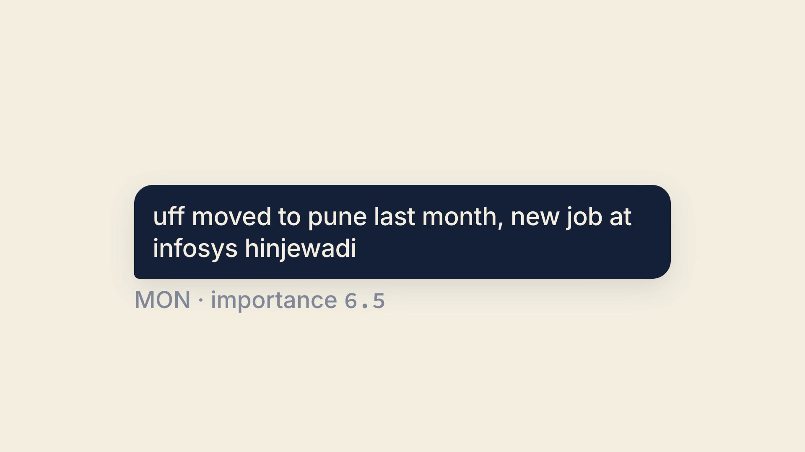

# Recallix

Persistent memory for AI agents: store what a user tells any of their agents, recall it
later by meaning, keep facts up to date, and say "I don't know" instead of guessing.

[](https://recallix.vercel.app/videos/recallix-demo.mp4)

*50-second demo, narrated (click to play). Every message, answer and timing in it comes from a real run.*

* **No LLM in the memory pipeline.** Fact extraction, schema tagging, importance, ranking,
  reflections and predictions are rules, embeddings and small fitted models. Nothing generates
  text. Three small encoder models run locally on CPU: the embedding model (bge-small, 33M
  parameters; or Ollama / an API), the answer check (a SQuAD 2.0 reader, 125M) and, for deep
  recall, a re-ranker (MiniLM cross-encoder, 22M). No per-token bill, no API key.
* **Per-user HNSW vector engine in C++** (NEON / AVX2), rebuilt from SQLite on start, so
  the engine can restart at any time without losing anything.
* **Learned, explainable recall.** Each result carries its relevance and the feature
  breakdown behind it, plus a top-level `answer` (the span a local reader found). Weights
  and the abstention threshold are fitted on labelled data, and the ranker refits itself
  nightly from your users' feedback (`mem.used(out)`), keeping a new fit only if it ranks
  better on feedback it was not fitted on.
* **Deep recall for spread-out answers.** `mem.recall(question, deep=True)` re-reads 50
  candidates with a small local re-ranker: slower, but finds more of the evidence when the
  answer is spread over several memories. Measurements: [`eval/results/retrieval_fixes/`](eval/results/retrieval_fixes/).

## Measured results

Copied from [`eval/results/RESULTS.md`](eval/results/RESULTS.md) (generated 2026-11-24 on an
Apple M4; regenerate with the commands in [`eval/README.md`](eval/README.md)). The website's
Benchmarks page reads the same files. Embeddings: `BAAI/bge-small-en-v1.5`, real engine, no LLM
anywhere, API cost $0.

**LongMemEval_S** (public benchmark: 500 questions over 246,750 chat turns; never used to fit or
choose anything, each run uses a configuration fixed beforehand). Share of each question's
evidence in the top 10:

| recall@10 | overall | multi-session | temporal | knowledge update | single-session user | preference |
|---|---|---|---|---|---|---|
| **Recallix ranking** | **0.860** | **0.748** | **0.838** | **0.963** | **0.977** | 0.717 |
| Recallix, served (default) | 0.727 | 0.559 | 0.622 | 0.928 | 0.953 | 0.744 |
| Recallix, served (deep recall) | 0.763 | 0.649 | 0.668 | 0.965 | 0.922 | 0.722 |
| Dense vectors (same embeddings) | 0.798 | 0.737 | 0.674 | 0.903 | 0.898 | **0.828** |
| BM25 | 0.767 | 0.636 | 0.753 | 0.889 | 0.930 | 0.444 |

The ranking puts 8% more evidence in the top 10 than dense search with the same embeddings.
What is *served* is lower, because recall declines when its answer check finds no answer: it
declined 56.7% of the 30 unanswerable questions, but also 16.6% of the 470 answerable ones. The
answer check's threshold was set on a different dataset and needs calibrating per deployment.
Earlier runs stay in [`eval/results/`](eval/results/) (`longmemeval_s_*.json`).

**Memory pipeline**: held-out test split, real engine:

| Metric | Result |
|---|---|
| Recall hit@1 / hit@3 (answerable questions) | 0.86 / 0.93 |
| Unanswerable questions correctly declined | 3/4 (false abstention on answerable: 0.07) |
| Fact extraction F1 | 0.93 |
| Schema accuracy | 0.85 |
| Importance ROC AUC | 1.00 |
| Recall / store latency, p50 (incl. embedding) | 41.3 ms / 16.1 ms |
| Legacy adversarial gauntlet v1–v3 | 8/12 |
| Legacy 500-turn retention, recall@1 | 7/8 |

The test split has been evaluated several times during development, so treat it as a
regression check rather than an unseen benchmark.

**LoCoMo** (public benchmark; test split: 5 conversations, 3,122 turns, 987 questions; held out
from fitting, but evaluated repeatedly during development). Evidence retrieved, no LLM involved:

| recall@10 | overall | multi-hop | temporal | open-domain | single-hop |
|---|---|---|---|---|---|
| **Recallix** | **0.659** | 0.363 | **0.650** | 0.340 | **0.793** |
| Dense vectors (same embeddings) | 0.570 | **0.393** | 0.584 | **0.351** | 0.646 |
| BM25 | 0.527 | 0.208 | 0.543 | 0.293 | 0.651 |

Recallix declined 31.6% of LoCoMo's 209 adversarial questions (they attribute something the
conversation did discuss to the wrong person) and wrongly declined 9.0% of the 778 answerable
ones. Multi-hop questions, whose answer is spread over several messages, are the weak spot;
deep recall (`deep=True`) raises them most. Measurements:
[`eval/results/retrieval_fixes/`](eval/results/retrieval_fixes/).

The legacy gauntlet and retention benchmarks are the pre-existing ones from this repository.
Earlier versions of this README reported 10/12 and 75% for them. Those scores depended on
answers hardcoded into the recall code (e.g. a fixed alias table), which has been removed.

**Vector engine** (single thread, recall@10 against exact search, M=16, efConstruction=100, efSearch=50):

| Vectors | Dim | Data | Recall@10 | Search avg / p99 | Build |
|---|---|---|---|---|---|
| 100,000 | 128 | clustered | 0.980 | 0.082 / 0.116 ms | 8.8 s |
| 100,000 | 384 | clustered | 0.956 | 0.164 / 0.274 ms | 25.3 s |
| 1,000,000 | 128 | clustered | 0.921 | 0.173 / 0.648 ms | 127 s |
| 100,000 | 128 | uniform random | 0.189 (hnswlib: 0.190) | 0.149 ms | 17.9 s |

Uniform random vectors are the known worst case for HNSW; the reference implementation
(hnswlib) gets the same recall on the same data, which validates the engine. These numbers exclude
the Python API and the embedding model.

**Limits worth knowing:**
* The eval sets are small and were written by the same author as the extraction rules.
* Fact extraction is rule-based. It misses phrasings such as "we have a…", "rescheduled to"
  and "also called"; unextracted facts are still stored and searchable, just not versioned.

## Architecture

```
client ──X-API-Key──▶ FastAPI (server.py)
                        ├─ store:  dedupe → embed once → facts → schema → importance
                        │          → SQLite (row + embedding + FTS5) → engine /add
                        ├─ recall: aliases → FTS5 + entity index + user's HNSW → learned ranker
                        │          → truth arbitration → multi-hop → abstain below threshold
                        ├─ index sync: SQLite → engine (startup, engine restart, reindex)
                        └─ jobs: world state · next-topic prediction · reflections · forgetting
                      SQLite (system of record)        C++ engine (one HNSW index per user)
```

Diagrams: [`docs/architecture_high_level.puml`](docs/architecture_high_level.puml),
[`docs/architecture_technical_depth.puml`](docs/architecture_technical_depth.puml).

## Getting started

**Docker (recommended):**

```bash
git clone https://github.com/AyishikD/Recallix && cd Recallix
docker compose up -d                                       # engine + API on localhost:8000
docker compose logs recallix | grep -A1 "admin API key"    # printed once: save it
docker compose exec recallix python -m backend.tools.keys create --user alice
pip install recallix                                       # Python SDK + recallix-mcp
npm install recallix                                       # TypeScript / Node 18+
```

```python
from recallix import Memory
mem = Memory(api_key="rx_...")
mem.store("I moved to Pune last month.")
print(mem.recall("Where do I live?")["memories"][0]["content"])
```

**From source:**

```bash
pip install -r requirements-local.txt           # API + local embeddings and answer check
cmake -S backend/infra_cpp -B backend/infra_cpp/build -DCMAKE_BUILD_TYPE=Release
cmake --build backend/infra_cpp/build -j

python -m backend.tools.setup_env               # writes the engine secret to .env, prints an admin key
set -a; source .env; set +a
./backend/infra_cpp/build/memory_service &      # vector engine
python server.py                                # API on 127.0.0.1:8000
```

Then create a key (`python -m backend.tools.keys create --user alice`) and use the
[Python SDK](sdk/python) or [TypeScript SDK](sdk/typescript). Full walkthrough:
[`docs/quickstart.md`](docs/quickstart.md). Endpoints: [`docs/api_reference.md`](docs/api_reference.md).
All settings live in [`config.yaml`](config.yaml). Secrets come only from the environment.

## Security model

* API keys are random tokens stored only as SHA-256 hashes, with roles: `user` (acts as itself),
  `service` (may act for its end users), `admin` (maintenance endpoints).
* Each user has a separate vector index; private memories are visible only to the agent that
  wrote them, enforced in SQL.
* Deleting a memory removes its vector, long-term copy and timeline entry. Clearing a user
  removes their data from every store.
* The engine binds to localhost and refuses to start without `RECALLIX_INTERNAL_KEY`.

## Development

```bash
pip install -r requirements-dev.txt
RECALLIX_ENGINE_BIN=backend/infra_cpp/build/memory_service python -m pytest tests
ctest --test-dir backend/infra_cpp/build --output-on-failure   # includes a ThreadSanitizer run
python eval/run_eval.py --split dev -v
```

CI (`.github/workflows/backend.yml`) builds the engine on Linux (AVX2) and macOS (NEON), runs
the C++ tests under ThreadSanitizer, the API/integration tests against the real engine binary,
and an eval regression gate.

`examples/multi_agent_handover.py` is the multi-agent demo (the agents use an LLM;
Recallix does not).

## License

- **Recallix (server, engine, everything in this repository except the SDKs):**
  [Functional Source License 1.1, ALv2 Future License](LICENSE) (FSL-1.1-ALv2).
  - **What you may do:** use, modify and self-host it for anything, including inside your own commercial
    products.
  - **What you may not do:** offer it, or a substantially similar product built from it, as a competing
    commercial product or service.
  - **Each version becomes Apache 2.0** two years after release.
- **Client SDKs** ([`sdk/python`](sdk/python), [`sdk/typescript`](sdk/typescript)), published as `recallix` on PyPI and
  npm: [Apache 2.0](sdk/python/LICENSE).
- **Earlier releases:** versions up to commit `e5fddcd0` (2026-11-24) were released under Apache 2.0 and stay available
  under it.

"Recallix" and its logo are trademarks of Ayishik Das; see [NOTICE](NOTICE).
